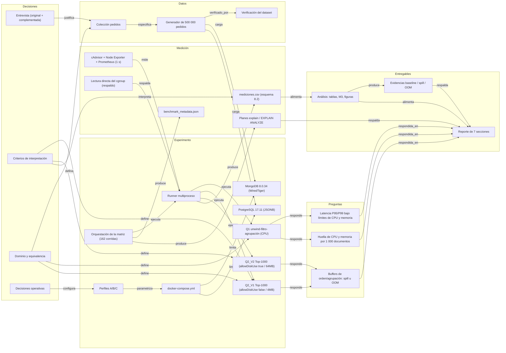

# Grafo de conocimiento del proyecto

Relaciona las preguntas del playbook (M1–M3) con las decisiones, los componentes, los archivos y las evidencias que las responden. La versión para procesar con código está en `grafo.json` (nodos con tipo y archivo; aristas con relación).

## Cómo leerlo

- **Trazabilidad hacia atrás:** desde `REP` se llega a la evidencia (`CSV`, `EXP`, `EVI`), al runner que la produjo, a las consultas y, por último, a las decisiones (ADR) y a la entrevista.
- **Cobertura:** cada pregunta M1–M3 tiene al menos una consulta que la responde y termina en el reporte.
- Requisito → archivo: `entregables/CHECKLIST.md`.
