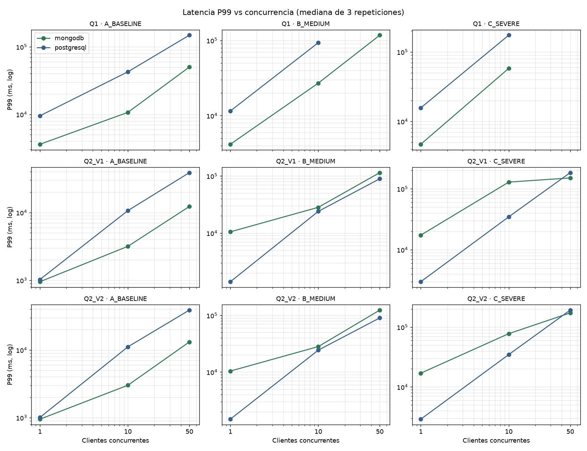
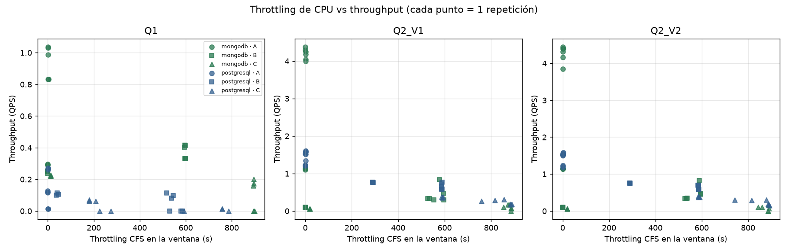
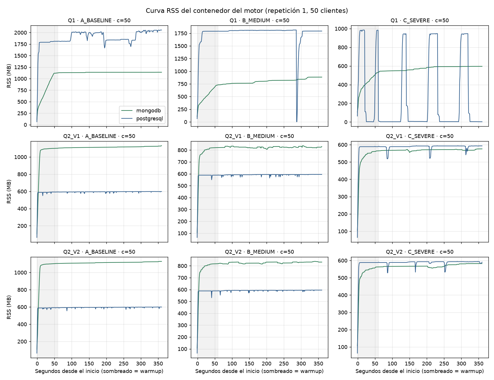

# Reporte de métricas — MongoDB frente a PostgreSQL JSONB bajo contención de CPU y memoria

**Bases de Datos en la Nube · IT2iD · Universidad Politécnica de Chiapas · 2026**  
Dominio: pedidos en línea de una cadena ficticia de abarrotes (12 sucursales en Chiapas).

> Todos los números de este reporte salen de `entregables/mediciones.csv` (162 filas, una por repetición), de `results/raw/` o de los planes en `results/explain/`. Ninguno se estimó. Salvo que se indique otra cosa, las cifras son la **mediana de 3 repeticiones**.

## Preguntas de investigación

- **M1.** ¿Cómo cambian la latencia P95 y P99 de las agregaciones sobre documentos anidados cuando se limita de forma estricta la CPU y la memoria?
- **M2.** ¿Qué motor usa de forma más eficiente los buffers de ordenamiento y agrupamiento antes de volcar a disco temporal o fallar por falta de memoria (OOM)?
- **M3.** ¿Cuál es la huella de CPU y memoria por cada 1 000 documentos procesados en el motor documental frente al motor con JSONB?

---

## 1. Especificaciones del host y del entorno Docker

| Elemento | Valor |
|---|---|
| Equipo | Laptop Acer, Intel Core i7-13620H (6 núcleos P + 4 núcleos E, 16 hilos), 36 GB de RAM, SSD de 2 TB |
| Sistema | Windows 11 (build 26300) · WSL 2.6.3 · kernel `6.6.87.2-microsoft-standard-WSL2` |
| VM de Docker (`.wslconfig`) | 16 CPU · 24 GB (24 032 MiB visibles) · **swap = 0** |
| Docker | Docker Desktop 4.97.0 · Engine 29.9.2 · Compose 5.6.1 · containerd 2.4.2 · runc 1.5.2 |
| cgroups | **v2** (`cgroup2fs`) |
| Motores | MongoDB **8.0.34** (WiredTiger) · PostgreSQL **17.11** |
| Telemetría | cAdvisor v0.52.1 · Node Exporter v1.9.1 · Prometheus v3.5.0 (`scrape_interval: 1s`) |
| Runner | Python 3.12 · pymongo 4.19.0 · psycopg 3.3.6 · numpy 2.5.3 |
| Asignación de núcleos de la VM | motor `0-3` · runner `4-11` · telemetría `12-15` |
| Energía | Conectado a la corriente; NitroSense en modo original hasta el 31 oct ~18:04 y **Performance** después; sin suspensión. CPU ~42 °C durante la matriz |
| Periodo de medición | 31 oct 2026 12:53 → 1 nov 2026 16:21 (hora de México) |

Detalle completo y digests de las imágenes: `results/host/host_info.txt` y `results/versions.txt`.

**Incidencias** (detalle en ADR-003, anexo):
- **Cambio del modo de energía** a mitad de la matriz: no se encontró efecto medible (proporción P50 de 1.003 antes contra 0.998 después).
- **Apagón por batería** durante el cooldown de la corrida 124: ninguna corrida quedó a medias, y el script retomó solo.

No se descartó ni se repitió ninguna corrida.

**Limitaciones del entorno.** Docker Desktop corre dentro de la VM de WSL2: límites, throttling y `drop_caches` se aplican en esa VM. Hyper-V no fija los vCPU a núcleos físicos, y el i7-13620H combina núcleos P y E, así que una corrida puede ejecutarse en núcleos de distinta velocidad. Es un equipo portátil, sujeto a temperatura; se ejecutó conectado a la corriente y sin suspensión.

## 2. Método de medición y verificación del baseline

### 2.1 Dataset

500 000 pedidos sintéticos (semilla `20261031`, SHA-256 `43b43458…dc9d`), 3 niveles de anidamiento (`sucursal.ubicacion.coordenadas`), 2.997 líneas por pedido en promedio. El mismo archivo NDJSON se cargó en ambos motores: MongoDB en 117 s y PostgreSQL en 81 s. Índices equivalentes a los del playbook: identificador UUID y fecha ISO-8601 (ADR-002). Verificación: `results/dataset_verification.json`.

### 2.2 Consultas

| query_id | Forma (idéntica a playbook 5.1 / 5.2) | Configuración |
|---|---|---|
| Q1 | `$unwind lineas` → `precio_unitario > 50` (36.4 % de las líneas) → agrupar por ciudad × categoría (72 grupos) con suma, promedio y conteo | Por defecto |
| Q2_V1 | `estado = entregado` y `creado_en ≥ 2026-01-01` (159 208 candidatos) → orden descendente por `pago.total_final` sin índice → Top-1000 | `allowDiskUse: false` / `work_mem = 4MB` |
| Q2_V2 | Igual a Q2_V1 | `allowDiskUse: true` / `work_mem = 64MB` |

### 2.3 Matriz y protocolo

2 motores × 3 perfiles × 3 consultas (Q1, Q2_V1, Q2_V2) × 3 concurrencias (1, 10, 50) = **54 configuraciones × 3 repeticiones = 162 ejecuciones** (ADR-001).

| Perfil | CPU | Memoria | Swap | Caché del motor (25 % del límite) |
|---|---|---|---|---|
| A (baseline) | 4.0 | 4096m | 0 | WiredTiger 1 GB · `shared_buffers` 1GB |
| B (media) | 2.0 | 2048m | 0 | 0.5 GB · 512MB |
| C (severa) | 1.0 | 1024m | 0 | 0.25 GB · 256MB |

Ciclo de cada ejecución: **recrear el contenedor** con el perfil (cgroup nuevo) → `sync; echo 3 > /proc/sys/vm/drop_caches` → **warmup 60 s** → **medición 300 s** → **cooldown 60 s**. Un solo motor encendido a la vez. Orden aleatorio con semilla dentro de bloques por repetición (`results/plan.csv`).

**Carga:** lazo cerrado; N procesos con una conexión cada uno, sin pausas. Solo cuentan las consultas que empiezan y terminan dentro de la ventana. Sin timeout artificial: el límite de cada consulta es lo que queda de la ventana.

**KPIs** (definiciones en ADR-001 y ADR-003):
- `throughput_qps` = consultas completadas ÷ 300 s.
- P50, P95 y P99 sobre todas las latencias de la ventana.
- `cpu_throttled_seconds` = Δ `container_cpu_cfs_throttled_seconds_total`.
- `max_rss_mb` = máx `container_memory_rss` ÷ 10⁶.
- `disk_spill`: archivos temporales (PostgreSQL) o contadores de spill (MongoDB).
- `status` con prioridad `oom` > `error` > `spill` > `ok`.
- Fuente: Prometheus/cAdvisor, con verificación cruzada contra el cgroup.

**Resumen de repeticiones:** mediana de las 3 repeticiones con rango mínimo–máximo; los estados se reportan como frecuencias.

### 2.4 Verificación de los límites (celda piloto)

En MongoDB · C · Q1 · 10 clientes, el kernel aplicó `cpu.max = 100000 100000` (1 CPU), `memory.max = 1 073 741 824` y `memory.swap.max = 0`. El motor consumió 299.4 s de CPU en la ventana de 300 s (una CPU saturada). Prometheus y la lectura directa del cgroup coincidieron: 898.7 s y 894.8 s de throttling.

> **Nota sobre el throttling.** En cgroups v2, `throttled_usec` acumula el tiempo frenado de **cada CPU** donde corre el contenedor. Con un `cpuset` de 4 CPU y cuota de 1 CPU, el valor puede superar la duración de la ventana (≈ 3 × 300 s).

### 2.5 Verificación del baseline

En el perfil A, el throttling máximo fue **2.82 s en 300 s (0.94 %)**, por debajo del umbral del 1 %. Hubo **0 OOM y 0 errores** en las 54 corridas del perfil (`entregables/evidencias/baseline/verificacion_baseline.md`). El baseline está libre de contención de CPU y de memoria.

La única excepción es que **PostgreSQL vuelca a disco en Q1 incluso en el perfil A** (9 de 9 corridas). No es contención de recursos: con `work_mem` = 4 MB por defecto, el plan ordena los documentos completos (sección 5).

## 3. Resultados consolidados

Tablas completas (mediana [mín–máx] de cada KPI por configuración): `entregables/reporte/tablas_resumen.md`. Estados de las 162 ejecuciones: **ok 129 · spill 20 · error 7 · oom 6**.

### 3.1 P99 (ms) por perfil — 1 y 10 clientes

| Consulta | Motor | A · c1 | B · c1 | C · c1 | A · c10 | B · c10 | C · c10 |
|---|---|---|---|---|---|---|---|
| Q1 | MongoDB | 3 610 | 4 170 | 4 694 | 10 712 | 27 094 | 58 061 |
| Q1 | PostgreSQL | 9 522 | 11 540 | 15 675 | 42 697 | 93 400 | 174 388 ¹ |
| Q2_V1 | MongoDB | 952 | 10 523 | 17 384 | 3 169 | 28 302 | 128 867 |
| Q2_V1 | PostgreSQL | 1 027 | 1 408 | 2 991 | 10 677 | 24 029 | 34 708 |
| Q2_V2 | MongoDB | 948 | 10 410 | 16 994 | 3 009 | 28 178 | 77 725 |
| Q2_V2 | PostgreSQL | 1 007 | 1 473 | 2 894 | 11 132 | 24 387 | 34 727 |

¹ 2 de 3 repeticiones; la tercera no completó ninguna consulta.

### 3.2 Con 50 clientes

| Consulta | Motor | A | B | C |
|---|---|---|---|---|
| Q1 | MongoDB | P99 50 259 ms · 0.83 QPS | P99 117 420 ms · 0.33 QPS | **error 3/3**: ninguna consulta completada en 300 s |
| Q1 | PostgreSQL | P99 148 793 ms · 0.01 QPS · spill | **oom 3/3** | **oom 3/3** |
| Q2_V1 | MongoDB | P99 12 285 ms · 4.18 QPS | P99 114 561 ms · 0.47 QPS | P99 150 883 ms · ok 2 / error 1 |
| Q2_V1 | PostgreSQL | P99 38 809 ms · 1.51 QPS | P99 89 460 ms · 0.58 QPS | P99 184 421 ms · 0.18 QPS |
| Q2_V2 | MongoDB | P99 13 150 ms · 4.17 QPS | P99 124 133 ms · 0.48 QPS | ok 1 / **error 2** |
| Q2_V2 | PostgreSQL | P99 38 904 ms · 1.52 QPS | P99 90 395 ms · 0.58 QPS | P99 192 528 ms · 0.17 QPS |

### 3.3 Throttling y memoria

- **Throttling (s en la ventana de 300 s):** A ≈ 0–2.8; B ≈ 530–600; C ≈ 760–900 con 10 y 50 clientes. Con 1 cliente: MongoDB B = 0 y C ≈ 12–19, contra PostgreSQL B ≈ 40–290 y C ≈ 180–590.
- **RSS máximo:** MongoDB 410–1 140 MB, que crece con la caché de WiredTiger de cada perfil. PostgreSQL 35–600 MB en Q2, pero hasta **2 050 MB en Q1 con 50 clientes** en el perfil A.

### 3.4 M3 — Huella por 1 000 documentos (`m3_huella.md`)

| Consulta | MongoDB CPU ms | PostgreSQL CPU ms | MongoDB RSS MB | PostgreSQL RSS MB |
|---|---|---|---|---|
| Q1 (c1, A→C) | 6.9 → 9.0 | 21.2 → 29.4 | 1.82 → 0.90 | 0.20 → 0.20 |
| Q1 (c10, A→C) | 7.7 → 11.5 | 27.3 → 149.6 | 1.93 → 0.94 | 1.16 → 1.15 |
| Q2_V1 (c1, A→C) | 1.8 → 35.3 | 4.9 → 5.3 | 1.89 → 0.82 | 0.07 → 0.07 |
| Q2_V1 (c50, A→C) | 1.9 → 12.0 | 5.2 → 11.3 | 2.25 → 1.16 | 1.20 → 1.19 |

## 4. Análisis gráfico

**P99 contra concurrencia.** En los tres perfiles, el P99 crece casi linealmente con los clientes. El modelo es de lazo cerrado y el motor está limitado a una cuota fija de CPU, así que las consultas hacen cola. La pendiente se dispara al bajar de perfil: de 1 a 10 clientes, el P99 de Q2_V1 en MongoDB sube 3.3× en A pero 7.4× en C. Las curvas de MongoDB en Q2 se separan de las de PostgreSQL en cuanto se pasa de A a B: con 1 cliente, MongoDB pasa de 0.95 s a 10.5 s y PostgreSQL de 1.03 s a 1.41 s.

**Throttling contra throughput.** Los puntos forman tres grupos, uno por perfil:
- **A:** throttling ≈ 0 y el mayor QPS. MongoDB Q2 llega a unos 4.2 QPS y PostgreSQL a unos 1.5.
- **B:** throttling ≈ 600 s.
- **C:** throttling ≈ 900 s.

Cuando el throttling es alto, el QPS cae por debajo de 1 en todas las consultas. El throughput lo fija la cuota de CPU, no el motor.

**Curva RSS (50 clientes, repetición 1).**
- MongoDB sube durante el warmup hasta llenar su caché y se queda plano: sin picos ni caídas.
- PostgreSQL es plano en Q2 (~590–600 MB).
- En **Q1**, PostgreSQL muestra el fallo de memoria. En B llega a ~1 810 MB de 2 048 MB y cae a 0 hacia el segundo 285: el kernel mata un proceso y el servidor se reinicia. En C se ve un ciclo repetido de subir hasta ~980 MB, caer a 0 y recuperarse, unas 5 veces en 6 minutos.

## 5. Planes de ejecución

Planes completos en `results/explain/`, por motor y perfil: MongoDB con `explain("executionStats")`, PostgreSQL con `EXPLAIN (ANALYZE, BUFFERS)`.

**Q1 — MongoDB:** `COLLSCAN` (500 000 documentos examinados) → `$unwind` → `$match` → `$group` en memoria. Sin `usedDisk`. Tarda 7.0–7.6 s en explain en los tres perfiles: es una consulta limitada por CPU.

**Q1 — PostgreSQL:** `Parallel Seq Scan` (2 workers) → **`Sort` por ciudad de los documentos completos** (`width = 1539` bytes) → `Gather Merge` → `Nested Loop` con `jsonb_array_elements` → `Incremental Sort` → `GroupAggregate`.

El planificador **estima 16 491 123 filas** tras desanidar, porque supone unos 33 elementos por arreglo. En la realidad son **545 122**. Con esa estimación elige agrupar por ordenamiento en lugar de por hash, y ordena el JSONB completo antes de desanidarlo. Cada proceso escribe a disco: `Sort Method: external merge Disk: 241 952 kB` (líder), 265 424 kB y 258 304 kB (workers), y `temp written = 209 385` bloques. Con 50 clientes son 50 × 3 procesos ordenando a la vez. Eso explica los GB de archivos temporales y el OOM de la sección 6.

**Q2 — MongoDB:** `IXSCAN` sobre `creado_en` (227 297 claves) → `FETCH` (227 297 documentos) → `$sort` + `$limit` → `$project`. Tarda 0.98 s en A y **18.1 s en C**. El acceso por índice obliga a traer más de 227 000 documentos en orden aleatorio. Cuando la caché de WiredTiger (0.25 GB en C) no contiene la colección, esas lecturas van a disco.

**Q2 — PostgreSQL:** `Parallel Seq Scan` con filtro → `Sort Method: top-N heapsort Memory: 276 kB` por proceso → `Gather Merge` → `Limit`. Tarda 0.92 s en A. Con su índice disponible, PostgreSQL prefiere leer la tabla de forma secuencial y en paralelo.

**Q2_V1 contra Q2_V2:** en ambos motores el plan es **idéntico**. Con `LIMIT 1000` el ordenamiento es Top-K, que usa menos de 300 kB, así que `allowDiskUse` y `work_mem` no intervienen. Los P99 de V1 y V2 están dentro del ruido entre repeticiones.

**Consulta exploratoria sin LIMIT** (fuera del CSV):
- PostgreSQL con `work_mem` = 4 MB → `external merge Disk: 3 408–3 560 kB`.
- PostgreSQL con 64 MB → `quicksort Memory: 5 234–5 348 kB`, en memoria.
- MongoDB no usó disco (`usedDisk: false`) en ninguna variante, ni siquiera con `allowDiskUse: false`.

Esto demuestra que la variante de memoria solo importa cuando el ordenamiento no es Top-K.

## 6. Interpretación: límites de memoria, volcado a disco y throttling de cgroups

**Volcado a disco (M2).**
- **MongoDB** no volcó a disco en ninguna de sus 81 corridas.
- **PostgreSQL** volcó a disco en **todas** las corridas de Q1 que llegaron a ejecutarse (20 spill + 1 error con spill), en los tres perfiles. La causa no es la falta de memoria del contenedor sino el plan: la sobreestimación de `jsonb_array_elements` lleva a ordenar documentos completos con `work_mem` = 4 MB. Por ejemplo, en `postgresql_C_Q1_c10_r3` el contador `temp_bytes` subió de 127.8 GB a 145.8 GB en 300 s.

**OOM (M2).** Las 6 corridas con OOM son de PostgreSQL · Q1 · 50 clientes, en los perfiles B y C. En todas, `docker inspect` reporta `OOMKilled` y el log registra un proceso terminado por señal 9. Son 50 backends más sus workers paralelos, cada uno con sus buffers de ordenamiento, más `shared_buffers`, todo dentro de 2 GB o de 1 GB.

En el perfil A (4 GB), la misma carga llegó a 2 050 MB y sobrevivió, aunque con solo 0.01 QPS. MongoDB nunca superó su límite: su memoria está acotada por la caché de WiredTiger y se mantuvo estable.

**Respuesta a M2:** MongoDB administra mejor los buffers de agrupamiento y ordenamiento en estas consultas: 0 spill y 0 OOM. PostgreSQL depende de que el planificador estime bien. Con la estimación por defecto de `jsonb_array_elements`, vuelca a disco siempre y, bajo concurrencia con poca memoria, termina en OOM.

**Throttling de CFS (M1).** En cgroups v2, `throttled_usec` suma el tiempo frenado de cada CPU del `cpuset` (4 CPU con cuota de 1 o 2). Por eso B se queda cerca de 600 s y C cerca de 900 s. El throttling se satura en cuanto hay más trabajo que cuota, y a partir de ahí la latencia crece con la cola de clientes.

PostgreSQL recibe throttling **incluso con 1 cliente** en B (~290 s en Q2) y en C (~590 s), porque cada consulta usa 3 procesos (líder + 2 workers paralelos) que juntos rebasan la cuota. MongoDB ejecuta cada agregación en un solo hilo y en B con 1 cliente tiene throttling 0.

**Respuesta a M1:**
- En **Q1**, MongoDB tiene menor P95/P99 en todos los perfiles y degrada menos con 1 cliente (×1.3 de A a C, contra ×1.6 de PostgreSQL).
- En **Q2**, PostgreSQL es mucho más estable: con 1 cliente su P99 crece ×2.9 de A a C, mientras que el de MongoDB crece ×18.
- Con 50 clientes en el perfil C, MongoDB no completa Q1 en 300 s y PostgreSQL termina en OOM. Ninguno de los dos sirve esa carga con 1 CPU y 1 GB.

**Respuesta a M3:** MongoDB tiene menor huella de CPU por 1 000 documentos en Q1: 6.9–12 ms contra 21–150 ms de PostgreSQL, por el spill. En Q2, MongoDB solo es más eficiente en A (1.8 ms contra 4.9 ms). En B y C sube a 8–35 ms por las lecturas de `FETCH` fuera de caché, mientras PostgreSQL se queda en 5–11 ms. En memoria, PostgreSQL usa menos RSS por 1 000 documentos en Q2 (0.07–1.2 MB contra 0.8–2.3 MB): MongoDB ocupa su caché aunque no la necesite toda.

## 7. Recomendaciones técnicas para despliegues documentales en la nube

1. **Dimensionar la memoria según el conjunto de trabajo, no según la CPU.** En Q2, MongoDB pasa de 0.95 s a 10.5 s de A a B con 1 cliente y throttling 0: no es falta de CPU sino una caché de WiredTiger que ya no contiene los documentos que se leen por índice. Si se usa MongoDB con consultas por índice + `FETCH`, el límite del contenedor debe dejar que la caché contenga la colección o, al menos, la parte más consultada.
2. **En PostgreSQL con JSONB, revisar las estimaciones antes de producción.** La sobreestimación de `jsonb_array_elements` (16.5 M contra 545 k filas) provoca ordenamientos de documentos completos en disco. Hay varias opciones: envolver el desanidado en una función con `ROWS` realista, reescribir con una subconsulta que proyecte solo los campos necesarios antes de agrupar, o subir `work_mem` por sesión solo para esa consulta. Además, limitar el disco temporal con `temp_file_limit`.
3. **Controlar la admisión de consultas.** Con 1 CPU, 50 clientes simultáneos provocan que ninguna consulta termine (MongoDB) u OOM (PostgreSQL). Conviene poner un *pooler* (PgBouncer) o un límite de concurrencia en la aplicación, de unas pocas consultas pesadas por vCPU, y encolar el resto.
4. **Ajustar el paralelismo de PostgreSQL a la cuota de CPU.** Con `cpus` ≤ 2, `max_parallel_workers_per_gather = 2` produce throttling incluso con 1 cliente. En contenedores pequeños conviene fijarlo en `cpus − 1` o en 0.
5. **Dejar margen entre `shared_buffers` + memoria por consulta y el límite del contenedor.** PostgreSQL hizo OOM con 1.8 GB de 2 GB. Hay que tener en cuenta que cada backend y cada worker reservan su propia memoria de ordenamiento.
6. **Vigilar las métricas del cgroup, no solo las del motor.** El throttling (`container_cpu_cfs_throttled_seconds_total`) y `memory.events: oom_kill` anticiparon todos los fallos. Además, si se hace spill, el disco temporal crece mucho: el disco virtual de Docker llegó a más de 100 GB durante la matriz.
7. **Elegir el motor según la consulta dominante.** Para agregaciones que desanidan arreglos (Q1), MongoDB fue más rápido, más eficiente y nunca volcó a disco. Para filtrar y obtener un Top-K con poca memoria (Q2), PostgreSQL fue más estable gracias al escaneo secuencial en paralelo y al `top-N heapsort`.

---

## Anexo: trazabilidad

Decisiones: `docs/decisiones/ADR-001…003` (incidencias en el anexo de ADR-003). Requisitos → archivos: `entregables/CHECKLIST.md`. Mapa del proyecto: `docs/conocimiento/grafo.md`. Ficha técnica: `entregables/benchmark_metadata.json`. Evidencia por corrida: `results/raw/`, `results/logs/`, `results/limits/`.
